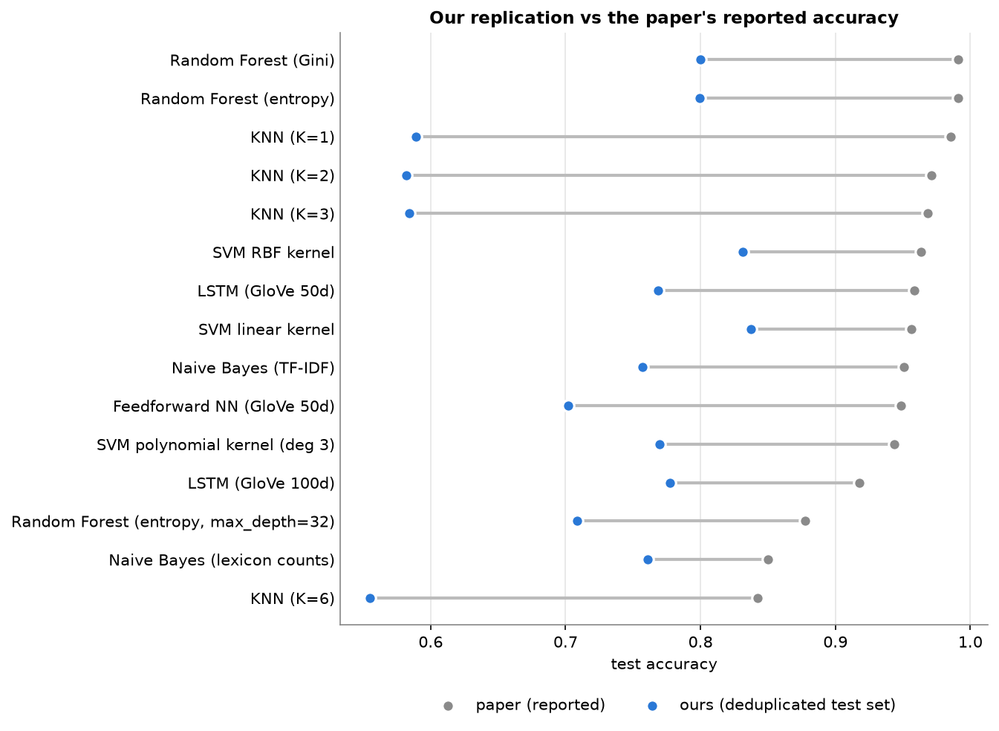

# Trolls, Haters, or Teammates? Classifying toxicity in PvP game chat

A replication and extension of the Stanford CS229 project
[*Trolls, Haters, or Teammates: Classifying Sentiment in the Language of PvP Game Communications*](https://cs229.stanford.edu/proj2021spr/report2/81982391.pdf)
(Borst, Yang, Zhu, 2021).

Each in-game chat message is assigned to one of three classes:

| Class | Meaning | Examples |
|---|---|---|
| **0** | neutral / positive | "ggwp", "thanks", "nice", "my bad" |
| **1** | negative attitude | "noob team", "such a feeder", "report this useless guy", "gg ez" |
| **2** | derogatory | slurs, sexist / racist / homophobic / ableist insults, "kys" |

> **Content warning:** the lexicons, error dumps and EDA plots contain offensive language. That is unavoidable for a toxicity classifier.

## Key findings

1. **Duplicates explain the paper's 99% scores.** About 58% of English game-chat messages are repeats ("gg", "ez", ...). If duplicates are not removed before splitting, **31.6% of test messages also appear word-for-word in train**. On those messages every model scores 92-100%, which is memorisation. On genuinely new messages, KNN (K=1) drops from the paper's 98.5% to **63.5%** (58.9% on our fully deduplicated test set).
2. **Honest labels give honest (lower) scores.** Our first version labeled messages with keyword rules, and models reached 98% by re-learning those keywords. We then **relabeled all 33,000 messages one by one with an LLM** following a written gamer-chat guideline (see [Labeling](#how-labels-were-made)). Agreement with a 298-message hand check rose from 83.2% (rules) to **95.3%** (Cohen's kappa 0.74 -> 0.93), and the best model's accuracy fell from 98.4% to **83.3%**, because the labels now depend on meaning (who is being insulted, is it about the game or a person), not on word lists.
3. **On clean data, linear models with character n-grams are still the best.** Best 3-class model: Logistic Regression on word + char TF-IDF (**83.3% accuracy / 0.845 macro F1**). Best binary model: linear SVM on char n-grams (84.5%).
4. **Our extension: game-chat fastText beats GloVe in all four comparisons** (feedforward and LSTM, 50d and 100d), by **+4.5 to +4.8 accuracy points**. fastText also builds vectors from character pieces, so misspellings like "retardd" or "n00b" are understood, while GloVe has no vector for 44% of our chat vocabulary. This supports the paper's conclusion that news embeddings don't understand gamer slang.
5. **Classic ML is still about as good as our neural nets.** The best LSTM (fastText 100d) reaches 82.4% / 0.833 macro F1, a point behind Logistic Regression, but several classic models (KNN, shallow Random Forest, Naive Bayes) are well below it.
6. **Fine-tuned DistilBERT is the best model, by a small margin.** Mean of 3 seeds: **84.3% accuracy / 0.854 macro F1** (std 0.5 / 0.3 points) vs 83.3% / 0.845 for Logistic Regression. The gap is about one point, so it is a modest edge, not a big win.
7. **Seed-to-seed noise is small (std 0.1 to 0.6 points for most models), so the main rankings hold.** The fastText-over-GloVe gap (4.5 points or more) and LSTM over feedforward are far larger than the noise.



*Not comparable with the paper's table:* the paper's models were trained on keyword-style labels and on duplicated data, so its 95-99% figures and our 55-85% are scores on different tasks.

## Results

All numbers are on the held-out **test set (6,600 messages)** of the deduplicated data, scored against the **LLM labels**
(see [Labeling](#how-labels-were-made)). The full table, with per-class F1 and validation scores, is in
[results/summary.md](results/summary.md) and [results/summary.csv](results/summary.csv).

| Model | Task | Features | Accuracy | Macro F1 | Paper accuracy |
|---|---|---|---:|---:|---:|
| SVM, linear kernel | binary (0 vs 1+2) | word TF-IDF | 0.838 | 0.836 | 0.9565 |
| SVM, RBF kernel | binary | word TF-IDF | 0.832 | 0.830 | 0.9635 |
| SVM, polynomial kernel | binary | word TF-IDF | 0.769 | 0.763 | 0.9435 |
| SVM, linear kernel (ours) | binary | char TF-IDF | **0.845** | **0.843** | – |
| Naive Bayes, lexicon dictionary | 3-class | lexicon counts | 0.761 | 0.758 | 0.8500 |
| Naive Bayes | 3-class | word TF-IDF | 0.757 | 0.761 | 0.9506 |
| Naive Bayes (ours) | 3-class | char TF-IDF | 0.786 | 0.797 | – |
| KNN, K=1 | 3-class | word TF-IDF | 0.589 | 0.567 | 0.9853 |
| KNN, K=2 | 3-class | word TF-IDF | 0.582 | 0.529 | 0.9711 |
| KNN, K=3 | 3-class | word TF-IDF | 0.584 | 0.542 | 0.9683 |
| KNN, K=6 | 3-class | word TF-IDF | 0.555 | 0.486 | 0.8424 |
| Random Forest, Gini | 3-class | word TF-IDF | 0.800 | 0.810 | 0.9912 |
| Random Forest, entropy | 3-class | word TF-IDF | 0.799 | 0.809 | 0.9910 |
| Random Forest, entropy, max_depth=32 | 3-class | word TF-IDF | 0.708 | 0.696 | 0.8775 |
| Logistic Regression (ours) | 3-class | word + char TF-IDF | **0.833** | **0.845** | – |
| Feedforward NN (ReLU, ReLU, softmax) | 3-class | GloVe 50d | 0.702 | 0.699 | 0.9486 |
| Feedforward NN | 3-class | GloVe 100d | 0.732 | 0.734 | – |
| Feedforward NN (ours) | 3-class | game-chat fastText 50d | 0.747 | 0.739 | – |
| Feedforward NN (ours) | 3-class | game-chat fastText 100d | 0.779 | 0.780 | – |
| LSTM | 3-class | GloVe 50d | 0.769 | 0.774 | 0.9586 |
| LSTM | 3-class | GloVe 100d | 0.777 | 0.785 | 0.9175 |
| LSTM (ours) | 3-class | game-chat fastText 50d | 0.817 | 0.823 | – |
| LSTM (ours) | 3-class | game-chat fastText 100d | 0.824 | 0.833 | – |

Rows in *italics* are our additions. The paper's Google-News word2vec models were skipped (1.6 GB download); we compare GloVe with our own game-chat fastText instead.

### Side experiment: what duplicates do

Same models, same size and class balance, but sampled **without** deduplication:

| Model | Accuracy, dedup | Accuracy, with dups | Accuracy on test messages *seen* in train | Accuracy on *unseen* messages |
|---|---:|---:|---:|---:|
| KNN, K=1 | 0.589 | 0.745 | 0.983 | 0.635 |
| Random Forest, entropy, depth 32 | 0.708 | 0.788 | 0.922 | 0.727 |
| Feedforward NN, GloVe 50d | 0.702 | 0.811 | 0.960 | 0.742 |
| Random Forest, Gini | 0.800 | 0.881 | 0.992 | 0.830 |
| Logistic Regression, word+char | 0.833 | 0.909 | 0.996 | 0.868 |

Every model's score goes up with duplicates; for KNN the gain is +16 points. All 23 models are in [results/summary.md](results/summary.md) and charted in [leakage_effect.png](results/figures/leakage_effect.png).

### Extension: GloVe vs our own fastText

| Embedding | Words with their own vector | Our vocabulary covered | Our running text covered |
|---|---:|---:|---:|
| GloVe (Wikipedia + news) | 400,000 | 56.1% | 90.3% |
| Game-chat fastText (ours) | 93,786 | 85.6% (100% via character pieces) | 98.2% |

| Word | Nearest neighbours in GloVe 50d | Nearest neighbours in our fastText 50d |
|---|---|---|
| bronze | silver, gold, medal | bronzev, bbronze, bronzw, bronz |
| ff | trelleborgs, malmo, viborg | gfinish, ffp, finihs, end, finish |
| gg | allin, kage, nomos | ggwp, ggwpp, ggwwp, ggj |
| toxic | radioactive, poisonous, wastes | toxick, toxics, toxin, toxix |
| feeder | overground, caledonian, mainline | dfeeder, ffeeder, feederr, feedeer |

GloVe's neighbours are unrelated news words; fastText's are mostly spelling variants of the same word, which is exactly what makes it robust to chat typos. More neighbours are in [results/embeddings.md](results/embeddings.md). Our fastText settings (window 3, 10 epochs, min_count 2, subwords of 3-6 letters) were picked by validation score among five variants, and all five scored higher on validation than our earlier word2vec.

## Data

Both datasets are public on Kaggle and must be **downloaded manually** into `data/raw/` (gitignored, ~940 MB):

| File | Dataset | Size used |
|---|---|---|
| `data/raw/chatlogs.csv` | [League of Legends Tribunal chatlogs](https://www.kaggle.com/datasets/simshengxue/league-of-legends-tribunal-chatlogs) (simshengxue) | all 1,697,222 messages |
| `data/raw/dota2_chat_messages.csv` | [GOSU.AI Dota 2 game chats](https://www.kaggle.com/datasets/romovpa/gosuai-dota-2-game-chats) (romovpa) | first 5,000,000 of 21.7M messages |

Neither dataset has message-level toxicity labels. The LoL report reasons apply to a whole game, not to a single message.

| Pipeline step | Messages |
|---|---:|
| Raw (LoL + first 5M Dota) | 6,697,222 |
| English-ish, non-empty, non-system | 4,456,960 |
| Unique after normalisation + deduplication | 1,851,646 (58.5% were duplicates) |
| Final balanced sample | **33,000**: 45% neutral / 30% negative / 25% derogatory |
| Train / validation / test (stratified, seed 42) | 21,120 / 5,280 / 6,600 |

### How labels were made

Labeling happened in two stages.

**Stage 1: lexicon rules (used to pick which messages to sample).** [src/labeling.py](src/labeling.py) assigns a weak label from word lists in [data/lexicons/](data/lexicons/) (neutral overrides, then derogatory, then negative, with obfuscation handling like `f4g` / `f*g` / `faaag`). Only about 1.5% of unique messages are derogatory, so these rules were used to draw a balanced 33k sample (45% / 30% / 25% by rule label). [tests/test_labeling.py](tests/test_labeling.py) has 64 test cases.

**Stage 2: LLM relabeling (the labels every model is trained and tested on).** All 33,000 messages were relabeled one at a time by an LLM (Claude), acting as an experienced LoL/Dota player and following the written guideline in [data/labeling_guideline.md](data/labeling_guideline.md). For example: swearing at the game or oneself is neutral, insulting skill or reporting is negative, and slurs / identity insults / "kys" are derogatory. Labels are stored in [data/llm_labels.csv](data/llm_labels.csv), and the train/val/test CSVs in `data/processed_v2/` carry both the final `label` and the old `label_lexicon`.

| | Neutral | Negative | Derogatory |
|---|---:|---:|---:|
| Lexicon labels (sampling target) | 45% | 30% | 25% |
| Final LLM labels | 43.4% | 33.7% | 23.0% |

The two label sets agree on 80.7% of messages. Most disagreements are keyword rules flagging swearing that isn't aimed at anyone, or missing insults with no listed keyword.

**Label quality check** ([data/manual_check.csv](data/manual_check.csv), 298 hand-labeled messages, `python -m src.label_agreement`):

| Labels | Accuracy vs hand labels | Cohen's kappa |
|---|---:|---:|
| Lexicon rules | 83.2% | 0.742 |
| LLM (final) | **95.3%** | **0.928** |

**Caveats:** (1) the LLM saw part of the hand-labeled sample (about 65 of 300 messages) before labeling, so the 95.3% is somewhat optimistic; (2) each message was judged alone, with no game context; (3) these are not human labels, and borderline calls ("gg ez", sarcasm, gaming uses of "rape") could go either way; (4) because messages were sampled with the lexicon, insult-heavy messages are over-represented compared with raw chat.

## Setup

Requires Python 3.13 (tested on macOS, CPU only; no GPU needed).

```bash
python3 -m venv .venv
source .venv/bin/activate
pip install -r requirements.txt
```

Then download the two Kaggle CSVs into `data/raw/` (see [Data](#data)).

## How to run

Run every command from the project root with the virtual environment active. Times are on a laptop CPU.

```bash
python -m src.prepare_data     # ~6 min  clean, dedup, lexicon-label, sample 33k, split -> data/processed/
                               #         (the LLM labels in data/processed_v2/ and data/llm_labels.csv are
                               #          included in the repo; they are not regenerated by a script)
python -m src.train_ml         # ~5 min  15 classic models x {dedup, with_dups}
python -m src.train_nn --dataset both
                               # ~8 min  8 neural models x 2 datasets; first run downloads
                               #         GloVe (~190 MB) and trains our fastText
python -m src.embeddings       # ~1 min  GloVe vs fastText coverage + neighbour report
python -m src.evaluate         # ~2 min  metrics, confusion matrices, summary tables
python -m src.error_analysis   #         misclassified test messages for the best model
streamlit run app/streamlit_app.py   # live demo at http://localhost:8501
```

Optional:

```bash
python -m src.label_agreement          # lexicon and LLM labels vs data/manual_check.csv
python -m src.error_analysis --all     # error dumps for every model
python -m pytest tests/                # labeler sanity tests
# EDA: open notebooks/01_eda.ipynb in VS Code (or re-run it headless:)
jupyter nbconvert --to notebook --execute --inplace notebooks/01_eda.ipynb
```

### Demo

The Streamlit app classifies a typed chat message. It shows the predicted class, a probability chart, a model selector (all 23 models, sorted by test macro F1), the label the lexicon rules would give (for comparison), and a "compare all models" view. The default model (Logistic Regression) predicts in about 0.02 s, and an LSTM in about 0.2 s.

## Project structure

```
data/
  raw/                  Kaggle CSVs (gitignored, download manually)
  lexicons/             editable word lists: derogatory, negative, neutral overrides, non-English markers
  processed/            lexicon-labeled splits (used for sampling), stats.json, fastText corpus
  processed_v2/         FINAL train/val/test splits with LLM labels (+ with_dups/); models read these
  llm_labels.csv        the LLM label for every message, with the old lexicon label
  labeling_guideline.md the written rules the LLM labeler followed
  manual_check.csv      300 messages for hand-labeling
src/
  config.py             paths, seed, class balance, split sizes
  text_utils.py         normalisation, English filter, tokenizer
  labeling.py           lexicon labeler used for sampling (lexicons + obfuscation-aware regex + context rules)
  prepare_data.py       raw -> clean -> dedup -> label -> sample -> split
  features.py           word / char TF-IDF and lexicon-count features
  train_ml.py           SVM, Naive Bayes, KNN, Random Forest, Logistic Regression
  embeddings.py         GloVe loading, our game-chat fastText, coverage report
  nn_models.py          feedforward NN + LSTM (Keras) and a text-in wrapper
  train_nn.py           neural training with early stopping
  model_io.py           one save/load format for every model
  evaluate.py           metrics, confusion matrices, summary tables, charts
  error_analysis.py     misclassified examples per (true, predicted) class pair
  label_agreement.py    lexicon and LLM labels vs hand labels (accuracy, Cohen's kappa)
  plot_style.py         shared colours and chart style
notebooks/01_eda.ipynb  class balance, message length, top words per class, duplicates
app/streamlit_app.py    demo
models/                 trained models + fastText vectors (gitignored, ~1.5 GB, regenerate with the scripts)
results/                summary tables, metrics, figures, error dumps, paper numbers
tests/                  labeler and English-filter tests
```

## Design decisions

- **Deduplicate before splitting.** Text is normalised (lowercased, "noooob" → "noob", URLs and extra whitespace removed) and then deduplicated, so no normalised message appears in more than one split.
- **Vectorizers live inside the scikit-learn pipelines**, so TF-IDF vocabulary and IDF weights are fitted on training text only.
- **The fastText corpus excludes validation and test messages**, so our embeddings never see evaluation text, and fastText word lookup also covers unseen spellings through character pieces.
- **Early stopping** (on validation loss, patience 4, best weights restored) replaces the paper's fixed 300–550 epochs. Models stopped after 12–45 epochs.
- **The embedding layers are frozen**, so the GloVe vs fastText comparison measures what each embedding knows, not what the network re-learned.
- **Macro F1 is reported alongside accuracy.** Accuracy is dominated by the largest class.
- **Reproducibility:** fixed seed 42 everywhere, deterministic TensorFlow ops, single-threaded fastText with a fixed hash. Re-running gives identical numbers.

## Seed variation and DistilBERT

Models that use randomness were retrained with 5 seeds (42 to 46) on the deduplicated data (`python -m src.seed_study`, output in `results/seed_study.csv`). SVM, Naive Bayes, KNN and logistic regression are deterministic, so they have no seed spread. DistilBERT (`distilbert-base-uncased`, fine-tuned with `src/train_bert.py`, 3 seeds, best epoch by validation loss) needs torch and transformers, which are kept out of `requirements.txt` (see `requirements-bert.txt`).

| Model | Test accuracy (mean ± std) | Macro F1 (mean ± std) |
|---|---|---|
| DistilBERT (3 seeds) | 0.843 ± 0.005 | 0.854 ± 0.003 |
| LSTM, fastText 100d | 0.824 ± 0.002 | 0.833 ± 0.001 |
| LSTM, fastText 50d | 0.819 ± 0.003 | 0.825 ± 0.003 |
| Random Forest (Gini) | 0.801 ± 0.001 | 0.811 ± 0.001 |
| LSTM, GloVe 100d | 0.779 ± 0.002 | 0.788 ± 0.003 |
| Feedforward, fastText 100d | 0.778 ± 0.001 | 0.780 ± 0.002 |
| LSTM, GloVe 50d | 0.771 ± 0.006 | 0.779 ± 0.006 |
| Feedforward, fastText 50d | 0.751 ± 0.003 | 0.745 ± 0.005 |
| Feedforward, GloVe 100d | 0.736 ± 0.003 | 0.741 ± 0.005 |
| Feedforward, GloVe 50d | 0.706 ± 0.003 | 0.709 ± 0.006 |

The seed only changes the model's initialisation and shuffling; the train/val/test split is fixed, so this does not capture variation from a different split. The tables above (single run, seed 42) are within the spread shown here.

## Label consistency check

A random 300 of the 33k messages were relabeled blind with the same guideline: 92% agreement with the stored labels (kappa 0.87). Almost all of the 24 differences are 0-vs-1 calls on short, ambiguous messages (for example "ez", "R u afraid?"). See `results/label_recheck.json`. Together with the 95% hand check, this puts the label noise at roughly 5 to 8%.

## Limitations

- **LLM labels, not human labels.** Scores measure agreement with an LLM's message-by-message judgement. It matches a 298-message hand check 95% of the time, but that check is slightly optimistic (the labeler had seen part of it) and borderline messages are inherently subjective. A full human annotation of even a few thousand messages would be the next improvement.
- **No game context.** Each message is labeled and classified alone; "ez" or "report" can be friendly or hostile depending on the match.
- **Sampling bias.** Messages were chosen with the lexicon, so very mild or novel toxicity that the lexicon never flags is under-represented.
- **Obfuscation.** The lexicon rules catch `f4g` / `f*g`; the trained models partly do via char n-grams and fastText subwords, but unusual spellings remain a weak spot.
- **English filter.** It is heuristic (an ASCII ratio check plus a non-English marker-word list), so some transliterated Russian and gibberish still gets through.
- **Subjective labeling choices.** For example, "bitch" aimed at someone and "kys" are class 2, and hero or item criticism is class 0. They are written down in [data/labeling_guideline.md](data/labeling_guideline.md).
- **Dota data is capped** at the first 5M of 21.7M rows (`DOTA_MAX_ROWS` in [src/config.py](src/config.py)). That is plenty for a 33k sample.
- **Single split.** Seeds were varied but not the train/val/test split, and DistilBERT was run on the deduplicated data only.

## Reference

K. Borst, T. H. Yang, M. Zhu. *Trolls, Haters, or Teammates: Classifying Sentiment in the Language of PvP Game Communications.* CS229 Final Project, Stanford University, Spring 2021. [PDF](https://cs229.stanford.edu/proj2021spr/report2/81982391.pdf)
